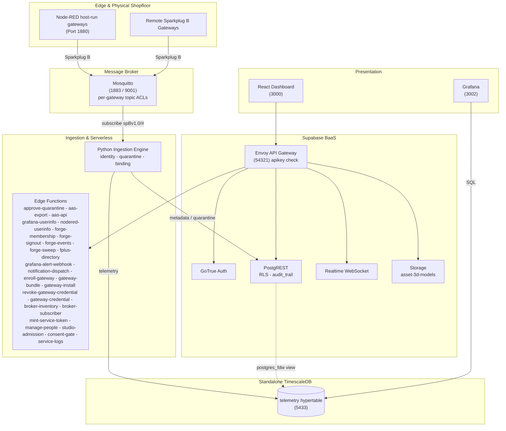

# How Aber fits together

What Aber is for and where it stops, what each part does, where its code lives, how it identifies
things, which standards it uses, and how it relates to the AMRC Connectivity Stack. Why the Kubernetes deployment is built the way it is has its own
document: [`kubernetes-architecture.md`](kubernetes-architecture.md).

> **Design ethos —** *use pre-existing components and standards; minimise custom code.*
> Where ACS ships bespoke microservices, Aber uses Supabase, TimescaleDB, Grafana and
> Node-RED. The custom surface is one Python ingestion service — a daemon and the modules beside it:
> the constraint engine, the metrics registry, capture and playback, the Directory and UNS publishers,
> cold archival — 24 edge functions, an i3X server and a React dashboard.

---

## Where Aber stops

**Aber collects, models, watches and exports a site's data. Grafana analyses it.** Use this line to
decide where a new feature belongs.

- **Aber shows the site as it is now, and what changed.** The Site Map draws the present state of
  every area, cell and device. The Audit Trail records every change.
- **Aber watches the readings and shows the alerts.** Every alert appears in Aber's dashboard.
  Aber evaluates the machine conditions a person writes as [automations](automations.md). Today
  Grafana evaluates the platform's own health rules ([`grafana/README.md`](../grafana/README.md)).
- **Aber hands the readings on.** An Administrator or a Shopfloor Manager exports them as files, 14 days at a
  time unless the site sets another limit, each export recorded in the Audit Trail. Other software reads them
  through [i3X](i3x-openapi.yaml). The equipment register is published as Asset Administration
  Shells.
- **Grafana is for analysis in depth.** There, a person builds dashboards, writes their own queries
  against the historian, and compares readings with other sources.
- **Aber builds none of those.** It has no dashboard editor, no query language and no saved panels.
  A feature that needs one belongs in Grafana, or is a separate decision.

## Architecture

**Supabase** is authoritative for asset metadata (`cells`, `gateways`, `devices`), auth, RLS, audit
triggers and edge functions. **Standalone TimescaleDB** holds the `telemetry` hypertable, reached
from Supabase through a `postgres_fdw` view. A **Python daemon** consumes Sparkplug B MQTT, gates
unregistered devices into quarantine, and routes metadata and telemetry to their respective stores.
A **React 18 SPA** queries PostgREST directly and subscribes to a Realtime change feed.

Derived state is computed at read time rather than stored: gateway staleness is a **view**, not a
cron writer, and AAS is an **adapter on the way out**, not an adopted metamodel.

**Data flow.** Devices publish `DBIRTH`/`DDATA` to Mosquitto, confined by ACL to their own edge-node
subtree → ingestion resolves topic to `sparkplug_id`, verifies the device is **bound to the
publishing gateway**, and quarantines anything unknown or contradictory → valid telemetry lands in
the hypertable → Postgres triggers log every metadata change to the append-only `audit_trail` →
the dashboard reads PostgREST and subscribes to Realtime.

---

## Components

**Every chart component appears here and every row names a real one**, asserted in both directions
by `scripts/check-docs-drift.mjs`, which also holds every image tag here to the chart's pin. The
chart's own images carry no tag: they are pulled at the chart's `appVersion`.

Hosts are `<name>.<domain>` on the one Ingress. On a laptop, `npm run dev:forward` publishes the
in-cluster ports on localhost: `5433` historian, `54322` Supabase Postgres, `54321` the API,
`1880` Node-RED, `3002` Grafana, `9090` Prometheus, `3100` Loki, `8090` i3X, `8088` docs.

| Component | Image | Reached at |
| :--- | :--- | :--- |
| `alloy` | `grafana/alloy:v1.21.3` | the one collector: logs, metrics and host metrics; `alloy:12345` |
| `area-plan-sweep` | `ghcr.io/harri-llewelyn/aber/ingestion` | CronJob: hourly, deletes the area plans no area names |
| `backup` | `supabase/postgres:17.6.1.175` | the nightly CronJob, when the backup service is off |
| `backup-service` | `ghcr.io/harri-llewelyn/aber/backup-service` | the Backups page's worker (`backupService.enabled`) |
| `claim-templates` | `ghcr.io/harri-llewelyn/aber/ingestion` | pre-upgrade hook Job: replaces a database StatefulSet whose claim templates a release relabelled ([`help/site/upgrading.md`](../help/site/upgrading.md#from-102-or-earlier-the-two-databases-statefulsets-are-replaced-once)) |
| `cold-archive` | `ghcr.io/harri-llewelyn/aber/ingestion` | CronJob: exports, verifies and drops cold chunks |
| `db-init` | `ghcr.io/harri-llewelyn/aber/db-init` | hook Job: the migration chain, on every install and upgrade |
| `db-roles-init` | `supabase/postgres:17.6.1.175` | hook Job: the Supabase roles and their passwords |
| `device-model-sweep` | `ghcr.io/harri-llewelyn/aber/ingestion` | CronJob: hourly, deletes the 3D models no device names |
| `e2e-aas-export` | `ghcr.io/harri-llewelyn/aber/test-runner` | Job (`e2e.enabled`): the AAS conformance suite |
| `e2e-validate` | `ghcr.io/harri-llewelyn/aber/test-runner` | Job (`e2e.enabled`): `validate.py` in-cluster |
| `frontend` | `ghcr.io/harri-llewelyn/aber/frontend` | `app.<domain>` |
| `gitea` | `gitea/gitea:28.3.0` | `git.<domain>` through the gateway's forge listener; SSH on `gitea-external` (LoadBalancer): 2222 where `npm run setup` wrote the values, else 22 |
| `grafana` | `grafana/grafana:13.3.0` | `grafana.<domain>` |
| `i3x-service` | `ghcr.io/harri-llewelyn/aber/i3x-service` | `i3x.<domain>` |
| `ingestion` | `ghcr.io/harri-llewelyn/aber/ingestion` | no route; `ingestion-metrics:9108` is scraped |
| `load-test` | `ghcr.io/harri-llewelyn/aber/test-runner` | Job (`loadTest.enabled`): synthetic Sparkplug load, applied by `scripts/load-test.mjs` |
| `loki` | `grafana/loki:3.7.9` | `loki:3100`, read by Grafana |
| `mosquitto` | `eclipse-mosquitto:2.1.2-alpine`, the `gateway-credential` sidecar, `jryberg/mosquitto-exporter:v0.7.9` when metrics are on | `mosquitto-external:1883` (LoadBalancer), 8883 with TLS; `mqtt.<domain>` for WebSockets |
| `node-red` | `ghcr.io/harri-llewelyn/aber/node-red` | `nodered.<domain>` |
| `playback` | `ghcr.io/harri-llewelyn/aber/ingestion` | the broker playback worker (`playback.enabled`); no route; `playback-metrics:9109` is scraped |
| `prometheus` | `prom/prometheus:v3.15.1` | `prometheus:9090`, read by Grafana |
| `realtime` | `supabase/realtime:v2.143.3` | behind `api.<domain>/realtime/v1`; Service `realtime-dev:4000` |
| `release-check` | `node:24.22.2-alpine3.24` | CronJob (`releaseCheck.enabled`, off by default): asks api.github.com once a day for the latest Aber release |
| `storage-init` | `node:24.22.2-alpine3.24` | hook Job: the storage buckets |
| `storage-policies` | `supabase/postgres:17.6.1.175` | hook Job: the storage RLS policies |
| `supabase-auth` | `supabase/gotrue:v2.197.0` | behind `api.<domain>/auth/v1` |
| `supabase-db` | `ghcr.io/harri-llewelyn/aber/supabase-db` (`supabase/postgres:17.6.1.175` with pgBackRest and tini), `quay.io/prometheuscommunity/postgres-exporter:v0.20.1` as a sidecar, and the `pgbackrest` backup sidecar when `supabaseDb.physicalBackup` is on | `supabase-db:5432`; `:9187` is scraped |
| `supabase-envoy` | `envoyproxy/envoy:v1.40.2` | the gateway: `api.<domain>` (in-cluster `supabase-envoy:8000`), Studio on 8001 when Studio is on, the forge on 8002, the forge's API for the edge functions on 8003 |
| `supabase-functions` | `ghcr.io/harri-llewelyn/aber/edge-runtime` | behind `api.<domain>/functions/v1` |
| `supabase-meta` | `supabase/postgres-meta:v0.100.0` | off by default, on with Studio; in-cluster only, for Studio |
| `supabase-rest` | `postgrest/postgrest:v14.18` | behind `api.<domain>/rest/v1`; admin port 3001 is scraped |
| `supabase-storage` | `supabase/storage-api:v1.81.0` | behind `api.<domain>/storage/v1` |
| `supabase-studio` | `supabase/studio:2026.10.12-sha-3699278` | off by default (`supabaseStudio.enabled`); `studio.<domain>` when its route is on too, behind the gateway's login |
| `swagger-ui` | `ghcr.io/harri-llewelyn/aber/swagger-ui` | `docs.<domain>`; the two specs are baked into the image |
| `test-api` | `curlimages/curl:8.23.0` | `helm test` Pod: GoTrue's health and PostgREST with the publishable key answer 200 through the gateway |
| `test-broker` | `eclipse-mosquitto:2.1.2-alpine` | `helm test` Pod: a wrong password gets CONNACK "not authorised", over TLS verified under the chart CA when broker TLS is on |
| `test-dashboard` | `curlimages/curl:8.23.0` | `helm test` Pod: the frontend Service serves the chart's `/config.js` |
| `test-db-tls` | `supabase/postgres:17.6.1.175` | `helm test` Pod (`postgresTls.enabled`): both databases refuse plaintext and every remote backend is on TLS |
| `test-fdw` | `supabase/postgres:17.6.1.175` | `helm test`: the postgres_fdw gate |
| `test-ingestion` | `curlimages/curl:8.23.0` | `helm test` Pod: the ingestion daemon reports itself subscribed to the broker and connected to the historian |
| `timescaledb` | `ghcr.io/harri-llewelyn/aber/timescaledb` (`timescale/timescaledb:2.31.0-pg17` with pgBackRest), `quay.io/prometheuscommunity/postgres-exporter:v0.20.1` as a sidecar, and the `pgbackrest` backup sidecar when `timescaledb.physicalBackup` is on | `timescaledb:5432`; `:9187` is scraped |
| `timescaledb-maintenance` | `ghcr.io/harri-llewelyn/aber/timescaledb` | hook Job: extension, retention, rollups, roles |

---

## Repository map

| Directory | Covers |
| :--- | :--- |
| **[`frontend/`](../frontend/README.md)** | React 18 architecture, Vite, Realtime integration, derived state, theming |
| **[`supabase/`](../supabase/README.md)** | Migrations, RLS privilege matrix, triggers, audit immutability, edge functions, the gateway |
| **[`ingestion/`](../ingestion/README.md)** | Sparkplug B parsing, identity resolution, gateway binding, TimescaleDB mapping, `validate.py` |
| **[`help/`](../help/README.md)** | The pages for newcomers: the install guide, the glossary, the dashboard's help for each page, and the [tutorial](../help/guides/tutorial.md), the walkthrough for a blank install (one cell, one gateway, its broker credential, a device, a schema, and the Node-RED flow that publishes as it) |
| **[`i3x/`](../i3x/README.md)** | i3X 1.0 server: address-space mapping, subscriptions, connecting a client — including [an MCP host](../i3x/README.md#mcp) |
| **[`deploy/k8s/README.md`](../deploy/k8s/README.md)** | Kubernetes runbook: prerequisites, the development loop, hardening, releases; its install, upgrade and teardown steps are [`help/site/running-the-server.md`](../help/site/running-the-server.md) |
| [`deploy/helm/aber/`](../deploy/helm/aber) | The Helm chart; `values.yaml` documents every setting |
| [`docs/kubernetes-architecture.md`](kubernetes-architecture.md) | Why the Kubernetes target is built the way it is. Source comments cite it by section |
| [`docs/incidents.md`](incidents.md) | Faults whose FIX LOOKS ARBITRARY without the story. Read before "tidying" a guard that seems redundant |
| [`help/site/upgrading.md`](../help/site/upgrading.md) | What survives an upgrade and why nothing needs reconfiguring — plus the four places that is not the whole truth, and the floor it holds from |
| [`docs/releases.md`](releases.md) | What a release promises: the supported window, what makes a version major, deprecation, and how a site learns a release matters to it |
| [`docs/openapi.yaml`](openapi.yaml) · [`docs/i3x-openapi.yaml`](i3x-openapi.yaml) | REST and i3X specifications, rendered by Swagger UI |
| [`supabase/migrations/archive/`](../supabase/migrations/archive) | The 197 superseded migrations, preserved for their reasoning. Never executed |
| [`grafana/`](../grafana) · [`timescaledb/`](../timescaledb) | Provisioning; hypertable schema, retention and rollup reconciliation, the read-only BI role |
| [`scripts/`](../scripts) | Setup, the dev loop, vocabulary generation, chart-file sync, drift guards, database backup/restore, gateway provisioning, AAS push |
| **[`test-harness/`](../test-harness/README.md)** | The test-runner image, the synthetic load generator and the scale envelope, the stack-only suites, the vendored IDTA AAS schema |
| [`forge/`](../forge) | Everything the platform publishes into the forge as a repository. `gateway-platform/` is the playbook every appliance converges to with `ansible-pull`, tagged at the platform's version; its `appliance/` is the compose project the appliance runs, which the installer lays down and the ZIP bundle ships |

---

## The schema every install applies

Every file in `supabase/migrations/` is applied by the `db-init` Job on every install and upgrade, and re-applied
harmlessly each time. At 1.0 there are two, the schema baseline (`0001`) and the seed data
(`0002`), which fold the incremental chain kept in
[`supabase/migrations/archive/`](../supabase/migrations/archive/README.md): the 197 files four squashes
retired. An archived number is never issued again, so a cited number names one file for good (the archive's two `0074`s predate the rule). The archive's
README says why each squash was shaped as it was, and each archived file states the decision it
made. The demo user accounts are seeded separately, by `supabase/seed.sql`.

> **The archive has no `0017`.** It was drafted as an audit-trigger change guard and then not written,
> because archived `0005` already implements one; a second declaration of
> `log_audit_trail_event()` would win by filename order on every boot and would have regressed
> the `actor_source` attribution it adds. The gap in the numbering is deliberate and the reasoning
> is in [`supabase/README.md`](../supabase/README.md#audit-signal-and-attribution-archived-migration-0005).
>
> Archived `0026` is that later declaration, written deliberately and on those terms: it reproduces
> archived `0005`'s body **in full** and adds two lines, rather than patching it. Its self-check
> asserts that both the heartbeat suppression guard and the causation stamp are present in the
> live definition, because
> `check-docs-drift.mjs` can verify a redeclaration was *intended* and cannot verify it was
> *complete*.

---

## How Aber identifies things

Most things in Aber have two kinds of id. The **key** is the row's own, in the platform database. The
**public ids** are what other systems see: on MQTT, in an Asset Administration Shell (AAS), in the i3X
address space, in a file or in a repository's name. This section gives both for each kind of thing. It
says which code makes each id, and which ids a site holds outside Aber. It is for people who change
Aber and people who connect another system to it.

- **A key never changes.** Renaming, moving, archiving and restoring a thing leave its key alone, and
  every id made from the key. A deleted thing's key is not used again. The database refuses an `UPDATE` that
  changes the `id` of a row of `areas`, `automations`, `cells`, `change_proposals`, `devices`,
  `directory_services`, `gateways`, `links`, `metric_catalog`, `metric_groups` or `schemas`, whoever sends
  it (`refuse_key_change()`).
- **A uuid key is its column's default**, `gen_random_uuid()`, unless a table below says otherwise. So
  each site has uuids of its own. A row a migration seeds with a fixed uuid has the same one on every
  site.
- **A name is a label**, unless a table below says a topic, a file or a type is made from it.
- **Changing an id a site already holds makes the release major**
  ([What the version number means](releases.md#what-the-version-number-means)). *Held outside Aber*
  says which those are.

### The plant

| Kind | Key | Public ids | Made by | Held outside Aber | May it change? |
| :--- | :--- | :--- | :--- | :--- | :--- |
| Site | None: one install is one site | The Sparkplug group, the primary host ID, the AAS base IRI and the cold archive's site key. The site's name, a segment of every UNS topic. `i3x:site` in i3X | The chart's values: `ingestion.sparkplugGroup`, `ingestion.primaryHostId`, `supabaseFunctions.aas.baseIri` and `coldArchive.s3.siteKey`. The `site.name` setting | Every gateway, MQTT client, exported shell and archived file | No, except the name, which moves every UNS topic |
| Area, cell | `areas.id`, `cells.id`: uuid | The uuid, as its i3X element id. Its name, unique, as a segment of a UNS topic | The column's default | i3X clients. UNS subscribers hold the name | No, except the name, which moves the topics below it |
| Gateway | `gateways.id`: uuid | `sparkplug_id` (`gwy…`): the edge node in its topics, its broker username, its i3X element id and its repository's name. The uuid, as its Factory+ Instance_UUID | [The Sparkplug id](#the-sparkplug-id). The Playback gateway's uuid is pinned in `0002` | The edge node, its credential, MQTT and Factory+ clients | No. Its Sparkplug group can be edited, which moves its Directory address |
| Device | `devices.id`: uuid | `sparkplug_id` (`dev…`): the key of its readings, its AAS ids and its i3X element id, and the id in its topic. The uuid, as its Factory+ Instance_UUID and in an automation's file. `reported_identity`, where it publishes an id of its own. Its name, as a segment of a UNS topic | [The Sparkplug id](#the-sparkplug-id). Ingestion records `reported_identity` when it first hears the device | The device or its edge node, exported shells, copied readings, automation files | No, except the name, which moves its UNS topics |
| Replay lane | A `devices` row with `shadow_of` set, so a uuid of its own | A `sparkplug_id` of its own. Its shell lists no `specificAssetIds` | `ensure_shadow_devices()` | No | No. It is deleted with the device it stands for |
| A device's metric | `asset_id` and `metric_name`, in the historian | The same pair: `<sparkplug_id>/<metric name>` in i3X | `ingestion/ingestion.py` | i3X clients, copied readings | No |

### The model

| Kind | Key | Public ids | Made by | Held outside Aber | May it change? |
| :--- | :--- | :--- | :--- | :--- | :--- |
| Schema version | `schemas.id`: uuid. `schema_name` is unique | The uuid, as its type's i3X element id and its Directory Schema_UUID, which is local. `semantic_id`, where it has one | `fork_schema()` and `apply_device_schemas()` name a new version | i3X and Factory+ clients | No. A draft can be renamed |
| Schema lineage | `lineage_root_id`: its first version's uuid | `lineage_name`: the key in its AAS Submodel ids, the name in a device schemas file, and its i3X `sourceTypeId` when it has no semantic id | `schemas_take_their_lineage()`, [Lineage names](#lineage-names) | Exported shells, AAS clients, device schemas files | Only while its first version is a draft |
| Metric, measured or derived | `metric_catalog.id`: uuid. Its name is unique, and is the key in practice | The name: on the wire, in readings, in files, and in its i3X type `i3x:type:metric:<name>`. `semantic_id` and the rows of `metric_semantic_ids`: the concepts it means | A person, or `apply_derived_metrics()` for a derived one | Every device that publishes it, and everything that reads it | The name, no: `enforce_metric_catalog_immutability()` refuses. Its semantic ids can be edited |
| Metric group | `metric_groups.id`: uuid. Its name is unique, whatever its case | Its name: what is before the first `/` of a metric's name | The generated column `metric_catalog.metric_group` | In metric names | No |
| A standard's entry | The standard's own name or id for it, in that vocabulary's table | Its semantic id | The generators, `scripts/generate-*-vocabulary.mjs`, into the seed. [Vocabularies](vocabularies.md) | Exported shells, i3X clients | No |
| Imported vocabulary | `site_vocabularies.id`: uuid. The file's SHA-256 is unique | Each concept's semantic id, as the file gives it | `import_site_vocabulary()` | Wherever the file came from | No |
| Submodel template's element | `template_id` and `path`, its idShortPath in the template. `template_id` and `id_short` in `idta_submodel_templates` | The template's IRI and the element's semantic id, as IDTA publishes them | The seed | Exported shells | No |

### People, machine identities and access

| Kind | Key | Public ids | Made by | Held outside Aber | May it change? |
| :--- | :--- | :--- | :--- | :--- | :--- |
| Person | `auth.users.id`: uuid | The uuid: the `sub` of every token, what Grafana finds their account by, and their forge username | GoTrue, through `manage-people`. `ensure_first_administrator()` makes the first | Grafana, the forge, registered apps | No. The email address and the display name can |
| Machine identity | `auth.users.id`: uuid, of an account that cannot sign in (`is_machine_principal()`). `machine_principals.principal_id` is the same id | The uuid: the `sub` of its tokens | `create_machine_principal()`. Four are pinned, in `0002` and `0181` | Its tokens | No. Its name and purpose can |
| API token | Its `jti`: uuid | The same | `mint-service-token`, `scripts/mint-api-token.mjs` and `scripts/lib/service-jwt.mjs` | Whoever holds the token | No |
| Role | `roles.id`: an integer, pinned in `0002` | Its name, such as `Shopfloor_Manager`, which is what code compares | The seed | No | No |
| Permission | `permissions.id`: uuid, pinned in `0002` | Its name, such as `telemetry:read`, which is what code compares | The seed | No | No |
| App that signs people in | `auth.oauth_clients.id`: uuid | The same, as its client ID | `register_app()`. Aber's own four are pinned in `0002` (`stack_app_ids()`) | The app's configuration | No |
| Broker account | Its MQTT username | The same: a gateway's is its `sparkplug_id`, and a read-only account's is `sub` and 21 random hex characters | The database, and `generateSubscriberId()` in `scripts/lib/mosquitto-credentials.mjs`. The chart's values name the platform's own | The client that signs in with it | No |
| Gateway setup token | `gateway_enrollment_tokens.id`: uuid | None. The token is a secret, and only its SHA-256 is stored | The database | Until it is used or expires | No |

### What happens, and what is kept

| Kind | Key | Public ids | Made by | Held outside Aber | May it change? |
| :--- | :--- | :--- | :--- | :--- | :--- |
| Audit Trail row | `audit_trail.id`, a number, with `recorded_at` | `entity_type` and `entity_id`: [what it is about](#entity_type-the-word-for-a-kind). `causation_id` groups the rows one transaction wrote, in this database only | `log_audit_trail_event()`, and each function that records its own act | A device's exported bundle | No |
| Change proposal | `change_proposals.id`: uuid | None. `entity_type` and `entity_id` name its subject | The column's default | No | No |
| Deleted asset | `entity_type` and `entity_id`, in `retired_entities` | The ids it had | `record_retired_entity()` | As before it was deleted | No |
| Recording, capture, playback | `capture_jobs.id`, `captures.id`, `playback_jobs.id`: uuid | A stored capture's object: `<subject's sparkplug_id>/<uuid>.json` | `start_capture_job()` and `begin_capture_upload()` | A downloaded capture holds the ids its devices published under | No |
| Backup | `backups.id`: uuid | `stamp`, such as `20261124T031500Z`: its folder, and its off-site copy's | `stampNow()` in `scripts/backup-service.mjs` | The off-site copy | No |
| Alert | `platform_alerts.id`: uuid, one for each time it fires. `fingerprint` and `starts_at` together are unique | The uuid, in a webhook message (`alert_id`). The fingerprint: Grafana's, or `condition:<trigger>:<device>:<metric>` | `automation_alert_fingerprint()` for an automation's, Grafana for the rest | Webhook receivers | No |
| Built-in alert rule | Its `uid`, in `grafana/provisioning/alerting/alert-rules.yaml` | The same, as `rule_uid` on its alerts | That file | Links to the rule in Grafana | No |
| Automation | `automations.id`: uuid | `key`: the `id:` in its file. A trigger's uuid, in the fingerprint and labels of its alerts | Whoever writes the file, and `apply_automations()` | Automation files, webhook receivers | No. A trigger keeps its uuid while it names the same device and metric |
| Suppression window | `alert_suppression_windows.id`: uuid | None | The column's default | No | No |
| Link | `links.id`: uuid | None. `entity_type` and `entity_id` name what it is on | The column's default | No | No |
| Notification | `notification_deliveries.id`: uuid | The uuid, as the webhook message's id | The column's default | Webhook receivers | No |
| Setting | `system_settings.key`, such as `site.name`. Its uuid is its Audit Trail `entity_id` | The key | The seed | No | No |
| Service in the Directory | `directory_services.id`: uuid, pinned in `0002` | The uuid, as its Directory Service_UUID, which is local | The seed | Factory+ clients | No |
| Exported bundle | `asset_exports.id`: uuid | Its object: `assets/<sparkplug_id>/<time>.aasx` | `exportObjectKey()` in `_shared/aas/bundle.ts` | The archive bucket | No |
| Gateway's repository | Its name: `gateways/gateway-<sparkplug_id>` | The same, and its deploy key's title, `gateway <sparkplug_id>` | `repositoryNameFor()` in `_shared/forge.ts` | The gateway's own clone, and every other | No |
| 3D model, area plan, picture | The object's path, which starts with its device's, area's or person's uuid | A 3D model's address, in exported shells | `modelStoragePath()`, `areaPlanPath()` and `picturePath()` in `frontend/src/utils/` | Exported shells hold a model's | A picture's, no. A model's follows its file's name, and a plan gets a new one at each upload |

### The Sparkplug id

A gateway or a device is addressed by its `sparkplug_id`: `gwy` or `dev`, then the first 21 hex
characters of its uuid, with no hyphens and in lower case. It is 24 characters in all.

- **The database makes it.** It is a `GENERATED ALWAYS … STORED` column of `gateways` and `devices`
  (`0001_baseline_schema.sql`), so nothing can write one.
- **The dashboard derives the same id** from a uuid, in
  [`sparkplugId.js`](../frontend/src/utils/sparkplugId.js). Mirror check 1 holds the two together. Nothing
  else in Aber derives it, outside the tests.
- **It does not give the uuid back.** It leaves out the last 11 characters. Look the row up by the column.
- **It is unique on the site.** Two uuids whose first 21 hex characters agree cannot both be devices.
  Fixtures that pin uuids must differ in those.
- **The length is fixed**, so ingestion can say an id on the wire was cut short, rather than only that
  it is unknown.
- **Some devices publish another id.** A device admitted from Quarantine may keep its own, and a
  Factory+ device may publish its uuid. Its readings are still kept under its `sparkplug_id`
  ([Asset Identity on the Wire](../ingestion/README.md#asset-identity-on-the-wire)).

### AAS ids and the base IRI

Every id in a shell is the base IRI, the device's `sparkplug_id` and what follows it. `buildEnvironment()`
in [`_shared/aas/shell.ts`](../supabase/functions/_shared/aas/shell.ts) makes them, for an exported file
and for `aas-api` alike.

| Id | Form |
| :--- | :--- |
| `globalAssetId` | `<base IRI><sparkplug_id>` |
| The shell | `<globalAssetId>/shell` |
| A Submodel | `<globalAssetId>/submodel/` and `Nameplate`, `PlatformConnection`, `DerivedMetrics`, `VisualRepresentation`, `<key>/OperationalTelemetry` or `<key>/KeyPerformanceIndicators` |
| A concept | The semantic id itself, with no base IRI |

- **The base IRI is the site's**, `supabaseFunctions.aas.baseIri`. The default, under `aber.local`, belongs
  to nobody. Changing it changes every id above, so it is fixed once a shell has been exported or read.
- **`<key>` is the schema lineage's name** as an idShort, unless `device_submodels.submodel_key` gives
  another. `assignSubmodelKeys()` in [`submodelKeys.ts`](../supabase/functions/_shared/aas/submodelKeys.ts) has the
  rule for two that clash.
- **`specificAssetIds`** also names the asset by its serial number, its product URI and its
  `sparkplug_id` ([Connecting an AAS client](../supabase/README.md#connecting-an-aas-client)).

### i3X element ids

A gateway or a device is its `sparkplug_id`, and a row with no identity on the wire is its uuid. A thing
with no row of its own has an id that starts `i3x:`. The
[i3X README](../i3x/README.md#element-ids) says which kind uses which, and why.

### The `aber.local` namespace

An id under `https://aber.local/` was minted by Aber. The name resolves nowhere on purpose: it claims no
standard's authority.

- **`https://aber.local/semantics/…`** is a concept whose standard publishes no id: MTConnect, ISO 22400 and
  VDA 5050. An id from OPC UA, ASHRAE 223P, QUDT or IDTA is the standard's own.
- **A metric no standard names has no semantic id.** None is minted for it.
- **`https://aber.local/i3x`** and **`https://aber.local/i3x/relationships`** are the namespaces of i3X's
  local types and relationships.
- **`https://aber.local/ids/asset/`** is the default base IRI, above.

Every site has the same semantic ids for the same concepts, so a shell from one site means the same at
another. They are ids a site holds outside Aber.

### Lineage names

Every version of a schema has a uuid and a name of its own: `Robot_Arm_Schema`, `Robot_Arm_Schema_v2`.
What outlives a version is its **lineage**, the versions made one from another.

- **`lineage_root_id` and `lineage_name`** are the first version's uuid and name, on every version.
  `schemas_take_their_lineage()` sets them, and no caller can.
- **A published version cannot be renamed**, so a lineage with one keeps its name. Renaming a first
  version that is still a draft renames its lineage.
- **Use the lineage's name for something that must survive a publish**, as a Submodel's id does. Use the
  version's uuid for something that must not, as an i3X type does: a version is a contract of its own.

### `asset_id` is a Sparkplug ID, except inside the dashboard

`asset_id` means two things. No API, file or table mixes them.

| Where | What `asset_id` holds |
| :--- | :--- |
| `telemetry`, its rollups and `telemetry_latest`, in both databases | The device's `sparkplug_id` |
| The functions that read them: `p_asset_id`, `asset_ids` | The device's `sparkplug_id` |
| `asset_config`, the parameters a device declared at birth | The device's `sparkplug_id` |
| A Unified Namespace message, a History export, an exported bundle's manifest, a file in the cold archive | The device's `sparkplug_id` |
| A device row in the dashboard's code, as `mapDeviceRow()` in `frontend/src/api.js` makes it | **The device's uuid**, the drawer's **Device UUID**. `id` on the same row is the same value |
| The `assetId` and `assetIds` arguments in `frontend/src/api.js` | Either. `toTelemetryKey()` turns a uuid into a `sparkplug_id` |
| The `Asset_ID` metric in a Sparkplug payload | The id the device claims. Ingestion checks it against the topic, which decides |

In new code, call a uuid `device_id` and a Sparkplug ID `sparkplug_id`. Use `asset_id` only for the
historian's column and what is read from it.

### `entity_type`: the word for a kind

Several tables say what a row is about with two columns: `entity_type`, a word for the kind, and
`entity_id`, which one.

**A new word is the table's name:** lower case with underscores, and plural for a new table. The audit
trigger stores the table's name, so almost every word is one already, and the Audit Trail turns each
into the label a person reads. A thing with no table in `public` takes the name its table would have, as
`service_logs` does. A new column uses these same words. A column that already holds singular words
keeps its style, so a new word there is singular too.

`audit_trail.entity_type` holds these. Drift check 566 holds the list to the dashboard's
`AUDIT_TRAIL_ENTITY_TYPES` and to `audit_trail_action_kinds()`.

| Word | What it is about | `entity_id` |
| :--- | :--- | :--- |
| `areas`, `cells`, `gateways`, `devices` | The row | Its uuid |
| `device_nameplate` | A device's nameplate | The device's uuid |
| `device_submodels` | A schema attached to a device | The device's uuid |
| `schemas` | A schema version | Its uuid |
| `metric_catalog` | A metric, measured or derived | Its uuid |
| `metric_semantic_ids` | A metric's further semantic ids | The metric's uuid |
| `site_vocabularies` | An imported vocabulary | Its uuid |
| `change_proposals` | A proposal that expired. One that was applied is filed under its subject | Its uuid |
| `automations` | An automation, with its triggers and actions | Its uuid |
| `capture_jobs`, `captures`, `playback_jobs` | A recording, the capture it stored, a playback | Its uuid |
| `platform_alerts` | **An alert across its occurrences**: each acknowledgement, and each withdrawal of one | Made from its fingerprint |
| `telemetry` | **Exports of readings**, all in one lane. Not a row of the historian | One fixed uuid |
| `user_roles` | **A person**: their account, roles, password, sessions, second factor, name, email address and app approvals. Not a row of `user_roles` | The person's uuid |
| `service_principals` | **A machine identity** and its tokens, with the acknowledgement of an alert about one. No table has this name: the table is `machine_principals` | The identity's uuid |
| `oauth_clients` | An app that signs people in. The table is GoTrue's, `auth.oauth_clients` | Its client ID |
| `broker_accounts` | A read-only broker account. The broker holds it, and no table does | Its username's hex characters, padded with zeros |
| `service_logs` | Reads of one service's log lines. No table | Made from the service's name |
| `notification_channels` | The webhook's signing key. No table | Made from the channel's name |
| `system_settings` | A setting | Its uuid |
| `backup_jobs`, `backups` | A request for a backup, and the backup it took | Its uuid |

A trail from an earlier release can also hold `area_floors`, `cell_links`, `gateway_links` and
`device_links`.

The other columns that hold a word for a kind:

| Column | Words | Style |
| :--- | :--- | :--- |
| `change_proposals.entity_type` | `areas`, `cells`, `device_nameplate`, `devices`, `gateways`, `schemas` | Table names |
| `retired_entities.entity_type` | `areas`, `cells`, `devices`, `gateways` | Table names |
| `asset_exports.entity_type` | `devices` | Table names |
| `platform_alerts.entity_type` | `device`, `gateway`, `platform`, `service_identity` | Singular: a Grafana rule's label says it. `platform` is an alert about Aber itself, and `service_identity` one about a machine identity's token |
| `links.entity_type` | `area`, `cell`, `device`, `gateway` | Singular |
| `captures.subject_kind` | `device`, `gateway` | Singular |
| `capture_jobs.subject_kind` | `device`, `gateway` | Singular |
| `capture_uploads.subject_kind` | `device`, `gateway` | Singular |

The dashboard spells a kind two more ways. The Audit Trail's filter says `AREA` or `SERVICE IDENTITY`
(`kind` in `AUDIT_TRAIL_ENTITY_TYPES`), and `entityUrl()` takes the singular. Neither is stored.

---

## Standards

| Standard | Role |
| :--- | :--- |
| **Sparkplug B** | The wire protocol. Identity is `sparkplug_id`, carried in the topic |
| **MTConnect** (2.x) | Machine-tool vocabulary — 249 data item types, 123 subtypes, 100 units, 126 component types |
| **OPC UA** (40001, 40001-2, 40001-4, 40010, 30050, 40501, 40540) | Companion-specification data points: machinery, process values, energy, robotics, PackML, machine tools, additive. Generated from OPC Foundation NodeSets by [`scripts/generate-opcua-vocabulary.mjs`](../scripts/generate-opcua-vocabulary.mjs) |
| **ISO 22400** | Computed KPIs, which MTConnect and OPC UA deliberately exclude |
| **ASHRAE 223P** | Building-system semantics — 640 concepts from the open223 ontology. ⚠ Still in public review |
| **QUDT** (3.5.2) | Quantity kinds and units — 1,126 quantity kinds, and the 83 units MTConnect's unit names map to, generated from QUDT's vocabulary files (CC BY 4.0, credited to QUDT.org) by [`scripts/generate-qudt-vocabulary.mjs`](../scripts/generate-qudt-vocabulary.mjs). A kind names what a reading measures, and an AAS export's `unitId` is a QUDT unit |
| **VDA 5050** | AGV readings — the 24 scalar fields of the `state` message that are readings, generated from the VDA's JSON Schema (MIT) by [`scripts/generate-vda5050-vocabulary.mjs`](../scripts/generate-vda5050-vocabulary.mjs). The protocol itself is not adopted |
| **AAS / IEC 63278** | V3 export as JSON or AASX, and a live read-only repository API (`aas-api`, IDTA-01002), validated against the official IDTA schema |

These are **six vocabularies, not six alternatives** — a mixed fleet needs all of them, which is
why the schema builder offers a choice rather than a migration path. All are built, as is the IDTA
Digital Nameplate; what each one covers and how its identity was verified is in
[`docs/vocabularies.md`](vocabularies.md), and the checklist for adding another is in
[`supabase/README.md`](../supabase/README.md#adding-a-vocabulary).

> Adopting the MTConnect vocabulary is not a compliance claim; that requires the Implementer
> License. Locally-minted semantic ids live under `https://aber.local/semantics/…` — the
> namespace is the honesty mechanism, and an id under `mtconnect.org` would assert an
> interoperability that does not exist.

---

## Relationship to ACS

**Aber is an independent project.** It was built from the ground up, taking the AMRC Connectivity
Stack's documentation as its inspiration, and contains no ACS code. It does not follow ACS releases
and is not intended to merge back. It is not affiliated with or endorsed by the AMRC.

What it keeps is interoperability with Factory+:

- **On the wire:** Sparkplug B, with the Factory+ metric naming rule and payload marker.
- **The Directory:** the read half of the Factory+ Directory's REST contract, at the unprefixed
  `/ping` and `/v1/…` paths a Factory+ client expects
  ([`fplus-directory`](../supabase/README.md#the-factory-directory-adapter)), and its documents on MQTT
  ([`directory_publish.py`](../ingestion/README.md#the-directory-on-mqtt)).
- **Identifiers are local.** Schema and service UUIDs are minted by each deployment rather than
  registered with the AMRC, and every response that carries one says so.
